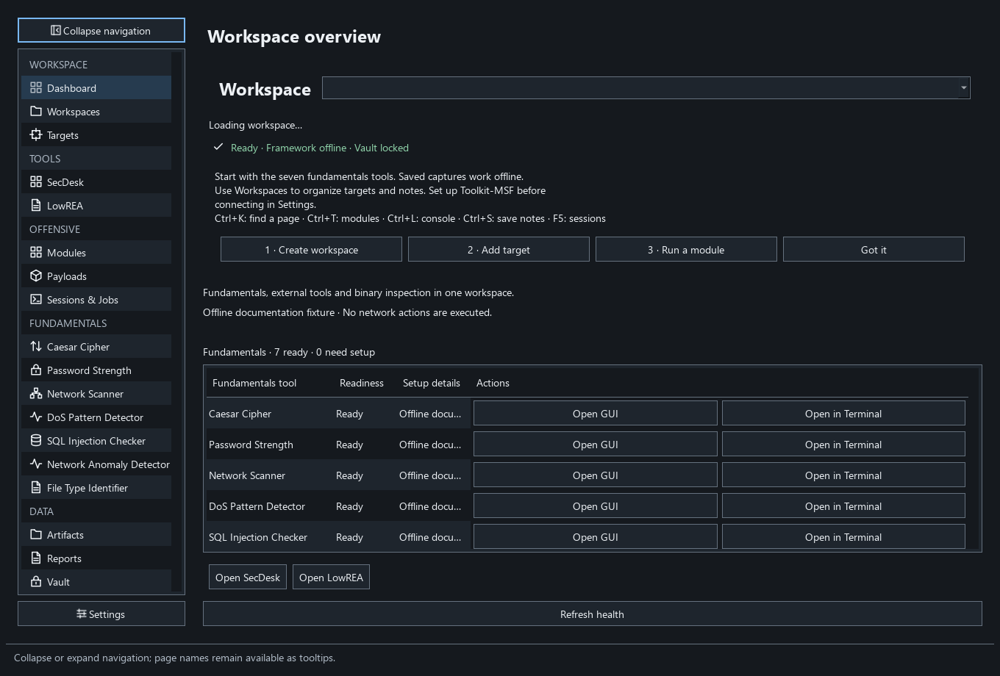

# Cybersecurity Fundamentals Toolkit

One native desktop application with seven fundamentals tools, local workspaces, Metasploit integration, an encrypted credential vault, and reports. Python 3.11/3.12, PyQt6, and a private authenticated HTTPS/WSS backend run in one desktop process. Errors remain local; no telemetry is enabled.

**Quick start:** install the unsigned Windows x64 package from [Releases](https://github.com/KreesM7/cybersecurity-fundamentals-toolkit/releases), then open **Cybersecurity Fundamentals Toolkit** from Start. Python is included. Alternatively, extract the entire portable ZIP and run its executable. The Linux AppImage targets Ubuntu 24.04+ x86_64. Nmap, libmagic, and Toolkit-MSF are separate optional prerequisites; setup messages identify affected tools.



The desktop backend listens only on loopback. This does **not** restrict scan/web targets to localhost: the scanner accepts bounded IPv4 targets, and the SQL checker accepts validated local/public URLs. Actions start from the Run/Launch buttons. Traffic analysis reads saved files; there is no live capture or DoS traffic generation.

## V2 features

| Area | Guide |
|---|---|
| Workspaces, targets, Nmap XML, sessions/jobs and console | [Workspace and activity guide](docs/ACTIVITY_AND_WORKSPACES.md) |
| Dedicated RPC installation and verified TLS | [Toolkit-MSF setup](docs/MSFRPC_SETUP.md) |
| Independently supervised PTY fallback | [PTY guide](docs/PTY_FALLBACK.md) |
| Module search, metadata/options, favorites and target transfer | [Module browser](docs/MODULE_BROWSER.md) |
| Payload generation, streaming progress, cancellation and Save As | [Payload guide](docs/PAYLOAD_GENERATION.md) |
| Encrypted vault, temporary candidates and explicit acceptance | [Vault guide](docs/VAULT.md) |
| Escaped reports; optional PDF with HTML fallback | [Reports](docs/REPORTS.md) |
| Themes, onboarding, shortcuts and optional update banner | [Desktop controls](docs/DESKTOP.md) |

## Setup and run

For source installation, install **64-bit Python 3.12 or 3.11**. The packaged Windows app does not need a separate Python installation. Open PowerShell in this project directory:

```powershell
py -3.12 -m venv .venv
.\.venv\Scripts\python.exe -m pip install -r requirements.txt
.\.venv\Scripts\python.exe -m toolkit
```

With the environment activated, the requested commands are:

```text
python -m toolkit
python -m unittest discover -s tests -v
```

On Windows, you can also double-click `Start-Toolkit.cmd` after setup, or run `.\Start-Toolkit.cmd` from PowerShell. It uses this project's environment and sets the correct working directory. Startup errors remain visible in its console.

If `py -3.12` reports **No suitable Python runtime found**, the environment was not created; the following `.venv` commands cannot work yet. Use an explicit path to a Python 3.12 executable instead. On a computer with Codex's bundled Python runtime, this fallback is available:

```powershell
$toolkitPython = Join-Path $env:USERPROFILE '.cache\codex-runtimes\codex-primary-runtime\dependencies\python\python.exe'
if (-not (Test-Path -LiteralPath $toolkitPython)) { throw 'Codex Python runtime not found. Install 64-bit Python 3.12 first.' }
& $toolkitPython --version
& $toolkitPython -m venv .venv
if ($LASTEXITCODE -ne 0) { throw 'Environment creation failed. Resolve the error above before continuing.' }
.\.venv\Scripts\python.exe -m pip install -r requirements.txt
if ($LASTEXITCODE -ne 0) { throw 'Package installation failed. Resolve the error above before continuing.' }
.\Start-Toolkit.cmd
```

The displayed version must be Python 3.12. The Codex cache path may change after an app update; a regular Python installation is the portable setup option.

Dependency pins live in `pyproject.toml`; `requirements.txt` installs the project and development/build extras. For reproducible builds use the transitive `uv.lock` as documented in [BUILD](docs/BUILD.md). Dashboard shows readiness; missing optional native components affect only their tools. Click Refresh health after setup. Restart after changing DLL paths. Core Qt/API dependencies are required to launch.

## Use the modules

| Module | Operation and interpretation |
|---|---|
| Caesar Cipher | Encrypt/decrypt ASCII letters using shifts 1–25; all 25 decryption candidates are shown. Case, punctuation, whitespace, and non-ASCII characters survive unchanged. Input is limited to 100,000 characters. This is a teaching cipher, not secure encryption. |
| Password Strength | Masked input; Show and Clear controls. zxcvbn estimates guesses, score, and `log2(guesses)` strength bits. Maximum 72 characters; no silent truncation. Common-list check is case-insensitive against a bundled 1,000-entry attributed sample. Times at 10, 10,000, and 10 billion guesses/sec are illustrations, not measured hardware performance. |
| Network Scanner | Choose **Entered target (system routing)** for a local or public IPv4 address/CIDR, or select a detected private interface to restrict the target to that interface's subnet. Maximum 256 total addresses. Fixed TCP ports: 21, 22, 23, 25, 53, 80, 110, 135, 139, 143, 443, 445, 3306, 3389, 5432, 5900, 8080, 8443. Open or closed ports prove a response; filtered/absent/timed-out results are inconclusive. Network/broadcast addresses are normally excluded by `IPv4Network.hosts()`; /31 and /32 follow Python's host rules. IPv6 and hostnames are not supported by this scanner. |
| DoS Pattern Detector | Choose a saved access log, request CSV, PCAP, or PCAPNG. Counts strictly above the threshold per source IP per UTC-aligned second are flagged. Default 100; logs/CSV count **requests**, captures count **packets**. A volume spike alone does not prove a DoS attack. |
| SQL Injection Checker | Load ordinary HTML forms from a local or public HTTP/HTTPS URL, using an IP address or hostname; select one and edit its values. Changing the URL clears loaded forms; late discovery results for a changed URL are discarded. POST starts disabled and must be explicitly enabled for each selected form. Two stable baselines precede three quote-only probes per eligible field. New SQL errors, status changes, or substantial content differences are reported as **possible issues**. At most 12 text fields are probed; hidden/select/check controls retain their values. No JavaScript rendering, authentication sessions, cookie handling, file upload, or multi-select emulation. |
| Network Anomaly Detector | Compare bytes, event counts, and protocol proportions with preceding bins. Defaults: one-second bins, 30 preceding bins, absolute z-score strictly greater than 3. The current bin never enters its own baseline. Empty bins count as zero. All baseline bins are required; otherwise "Insufficient baseline data" is reported. A changed value against zero variance is explicitly infinite z; an unchanged value has z=0. |
| File Type Identifier | libmagic reads at most the first 1 MiB and reports MIME, signature description, and extension comparison. Unknown extensions stay unknown. MIME aliases are handled for common archive/image types. Format identification does not establish safety; encrypted, polyglot, or partial files may be ambiguous. Handles are created inside each worker. |

Results and passwords stay in this process's memory. Clear removes visible password/results; Python and Qt do not guarantee secure memory erasure. Closing the app cancels workers and waits for them to finish. Cancellation discards partial task results. The scanner may take up to eight seconds to stop its current host scan; HTTP cancellation can wait for a bounded socket read. File analyses can be cancelled between records/bins. Technical tables show at most 5,000 results, with that limit disclosed in their status.

## Network operation

These checks live inside analysis functions, independently of the panels:

- Scanner: custom IPv4 targets can be local or public and use the operating system's routing. The entered address/CIDR must be unambiguous, aligned, and at most 256 addresses. Selecting a detected private interface instead restricts the subnet to that active RFC1918 adapter; attachment is rechecked before each host. Each host is a bounded TCP connect scan; there is no DNS, service detection, or Nmap script execution.
- Web: local/public IPv4/IPv6 unicast addresses and valid hostnames are accepted. `localhost` maps directly to `127.0.0.1`. Mapped/scoped IPv6, unspecified, multicast, link-local, reserved addresses, ambiguous numeric address forms, user-info URLs, and unsupported schemes are rejected. DNS answers receive the same address checks; hostname lookup is cancellable with a three-second deadline and at most two concurrent resolver threads. Each client resolves a hostname once per run, preferring IPv4, then connects to that pinned literal IP while preserving the original Host header and TLS hostname. It does not switch addresses during a run or automatically try other returned addresses. Form actions must retain the original scheme, hostname, and effective port.
- Redirects and proxy use are disabled. HTTPS certificate verification stays enabled; self-signed lab certificates must be trusted through the system's normal certificate configuration. TLS verification is never bypassed.
- One request per second across web workers; at most 40 per test run (two baselines plus at most 36 probes). Discovery is one separate request. Requests are URL encoded and limited to 64 KiB of form data. Connect timeout 3 seconds, read timeout 5 seconds, body-read deadline 10 seconds, maximum response 1 MiB. A 15-second watchdog bounds the whole request, including slow headers, and interrupts active sockets on cancellation. Servers must honor uncompressed responses. Dynamic baselines stop anomaly testing. Content similarity uses at most 1,024 block fingerprints across each response; this bounded heuristic can flag benign changes or miss subtle differences.
- The checker compares baselines with `'`, `"`, and `''` probes. POST follows the selected form and the panel's POST setting.

Run and Launch submit actions directly; no separate ownership declaration is required.

## Saved input formats

Text files use UTF-8. `.csv` identifies CSV, `.pcap`/`.pcapng` identifies captures, and other extensions are treated as Common/Combined access logs. Choose the correct extension. Maximum file size is 25 MiB and maximum accepted events is 250,000. Events are sorted by timestamp before analysis. Malformed rows are excluded, with row/line positions, skipped counts, and an **INCOMPLETE analysis** label; no valid events is an error. Captures receive a framing check so malformed/truncated files do not silently appear complete. Non-IP packets are excluded with a note. Payloads are not retained.

Request CSV requires:

```csv
timestamp,source_ip
2026-10-06T00:00:01Z,10.0.0.8
1791244802.25,10.0.0.9
```

Traffic CSV for anomaly detection requires all four columns:

```csv
timestamp,source_ip,bytes,protocol
2026-10-06T00:00:01+00:00,10.0.0.8,1200,TCP
2026-10-06T00:00:02Z,10.0.0.9,64,UDP
```

Timestamps are finite Unix seconds or timezone-bearing ISO timestamps. Naive dates are rejected. `source_ip` is a literal IPv4/IPv6 address; byte counts are nonnegative integers; protocol labels are normalized to uppercase. Extra CSV columns are ignored. Access logs use their explicit timezone, response byte count, and protocol label `HTTP`; unknown byte counts (`-`) can count as requests but are excluded from byte-volume analysis. PCAP byte volume uses recorded on-wire length, and protocol proportions count IP events, not bytes. These sources measure different things; compare like with like. Anomaly spans are limited to 100,000 bins and 64 distinct protocol labels; increase bin size, group uncommon protocols, or split long inputs. All anomalies are counted, but only the first 5,000 details are retained/displayed.

See [`examples/README.md`](examples/README.md) for reproducible small inputs and expected results.

## Windows native prerequisites

**Nmap:** Install the external executable from [Nmap's Windows instructions](https://nmap.org/book/inst-windows.html). It is discovered through `TOOLKIT_NMAP`, then `PATH`, then the standard `Program Files\Nmap` locations. For a custom install:

```powershell
$env:TOOLKIT_NMAP = 'C:\Program Files (x86)\Nmap\nmap.exe'
python -m toolkit
```

The toolkit uses unprivileged `-sT -Pn -n` connect scans, a fixed port preset, one retry, a five-second host timeout, and an eight-second process timeout per host. It manages the hidden Windows subprocess and uses python-nmap's XML analysis API; its constructor is bypassed to avoid an unbounded version subprocess and extra console windows. It does not install a capture driver. Nmap's own installer may offer Npcap, which this saved-file application does not need. A /24 can take several minutes when hosts do not respond. No live LAN scan is included in automated tests.

**libmagic:** `python-magic` is only a Python wrapper. It needs a matching **x64 DLL, all dependent DLLs, and magic database**. One compatible route is the [MSYS2 UCRT64 file package](https://packages.msys2.org/packages/mingw-w64-ucrt-x86_64-file). In an installed MSYS2 UCRT64 shell:

```text
pacman -S mingw-w64-ucrt-x86_64-file
```

Then start the Python app from PowerShell with:

```powershell
$env:PATH = 'C:\msys64\ucrt64\bin;' + $env:PATH
$env:TOOLKIT_MAGIC_FILE = 'C:\msys64\ucrt64\share\misc\magic.mgc'
python -m toolkit
```

Use one distribution/version for the DLL and database; keep dependent DLLs beside it. The wrapper recognizes `libmagic-1.dll`, among other standard names. Do not mix 32/64-bit files. If setup fails, the module displays instructions while the remaining toolkit opens. See [python-magic's installation notes](https://pypi.org/project/python-magic/). This delivery does not redistribute Nmap, libmagic, or MSYS2 native packages.

## Verification, packaging and extensions

The complete v2 suite uses `python -m pytest --cov --cov-report=xml`; `python -m unittest discover -s tests -v` remains the original fundamentals suite. CI enforces Black, Ruff, strict mypy and at least 75% coverage on Windows/Linux × Python 3.11/3.12. Tests use controlled local fixtures. Optional native-lab skips are identified explicitly; a skip does not establish readiness. See [verification](docs/VERIFICATION.md) and [independent security review](docs/SECURITY_REVIEW.md).

Build unsigned Windows installers/portable folders and Linux AppImages using [BUILD](docs/BUILD.md). Our source is MIT; the combined PyQt6/python-nmap desktop follows GPLv3. Scapy is an independently installed GPL-2.0-only worker and is excluded from the desktop. Source archives, notices and checksums accompany release assets; see [third-party notices](THIRD_PARTY_NOTICES.md).

See [extension interfaces](docs/EXTENDING.md), [API authentication](docs/API.md), [security policy](SECURITY.md), and [contributing](CONTRIBUTING.md). Git history records actual verified slices and is published in this repository. No Sentry telemetry is configured.

## Linux prerequisites

On Ubuntu 24.04+ x86_64 install Qt host libraries before using the AppImage:

```sh
sudo apt-get install libegl1 libopengl0 libxkbcommon0 libxcb-cursor0 libdbus-1-3 libgtk-3-0t64 libxcb-xinerama0 libxkbcommon-x11-0
chmod +x Toolkit-2.0.0-Linux-x86_64.AppImage
./Toolkit-2.0.0-Linux-x86_64.AppImage --appimage-extract-and-run
```

Install `nmap` and `libmagic1t64` for those tools. The AppImage includes Python and Qt, but requires Ubuntu host libraries and a desktop display. Headless verification uses `QT_QPA_PLATFORM=offscreen` and `--self-test`. See the build guide for FUSE-free execution and the Debian skeleton.

## Data and troubleshooting

Windows profiles live under `%APPDATA%\CybersecurityFundamentalsToolkit`; Linux uses `~/.cybersecurity-fundamentals-toolkit`. A `TOOLKIT_PROFILE` override selects an isolated profile. Back up the complete profile while the app is closed, including `mutation.key`, workspace databases and vault metadata. Never share the instance token, TLS keys or vault data in an issue. There is no forgotten-password recovery for the vault.

Analysis results and entered strength-check passwords stay in memory. Workspace records, explicitly accepted vault credentials, managed payload/report artifacts and settings persist locally. Reports and exported files are user-managed copies. Python/Qt cannot guarantee physical erasure of freed memory. Closing may briefly display a waiting message while owned helpers finish cleanup; external RPC servers remain running.

If startup fails, launch `Start-Toolkit.cmd` from the source checkout to read the local error. A failed Python environment creation must be fixed before running its executable. Do not disable certificate verification to fix TLS problems. Close other Toolkit instances before repairing a profile. Native setup errors on Dashboard include the relevant missing prerequisite. See each feature guide for bounded-input and uncertain-command limitations.

## Metasploit setup (v2)

See [dedicated Toolkit-MSF provisioning and verified TLS connection](docs/MSFRPC_SETUP.md). This setup leaves other WSL distributions untouched.

### Desktop navigation and guides

Use the grouped sidebar or **Ctrl+K** to find any page. Each tool has Run and Guide tabs;
**Try example** fills inputs without starting a test. Modules use Find, Configure, and
Review & Run; click Run after completing the selected module's options. Sessions, Jobs, and
Console have separate tabs; raw console controls require the Advanced console toggle.
Field help is available by focus, hover, and the question-mark buttons. Console **Save artifact**
exports the redacted display to a local text file; it does not add a workspace catalog entry.

[All desktop screenshots, both themes](docs/screenshots/README.md) use an offline fixture.
Regenerate them with `python scripts/capture_ui.py`; regenerate app icon exports with
`python scripts/render_app_icon.py`. The original Toolkit Line SVG glyphs share a 2-unit
stroke and are licensed with the application under MIT.

## LowREA (source checkout; implementation in progress)

`python -m toolkit lowrea inventory-artifact PATH` records a local file's byte
identity without executing it. It returns JSON evidence or a diagnostic with a
remediation and exits 0 or 1 respectively. No external analysis engine is required
for this operation. This is not a disassembler or the completed LowREA suite.
See [LowREA status](docs/lowrea/STATUS.md) and [integration design](docs/lowrea/DESIGN.md).
The published v2.1.0 installers do not include LowREA.


## SecDesk source integration

Open **SecDesk** in the sidebar for ten tool detail views, passive installation checks and explicit native/console launch controls. See [SecDesk status](docs/secdesk/STATUS.md), [sources](docs/secdesk/SOURCES.md) and [development resource rules](docs/DEV_WORKFLOW.md).


The 2.2.0 source candidate expands SecDesk to ten vendor-sourced tool manifests, explicit native terminals/GUI launches, linked commercial consoles, Burp/device guides and workspace findings. Use `python -m toolkit --profile work/secdesk-dev` while developing and `python -m toolkit secdesk doctor` for passive discovery. Tools are never silently installed or started. Native licensing/compatibility and firmware operations remain unverified where the required deployment/specification is unavailable; see [delivery status](docs/secdesk/STATUS.md). Published 2.1.0 installers do not contain these source changes.
